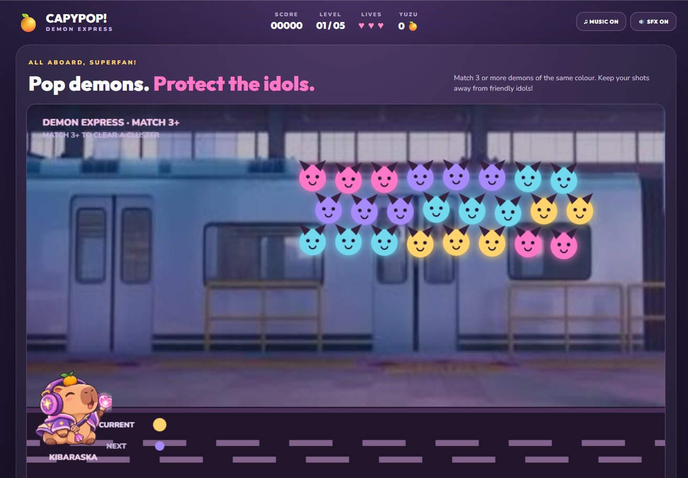
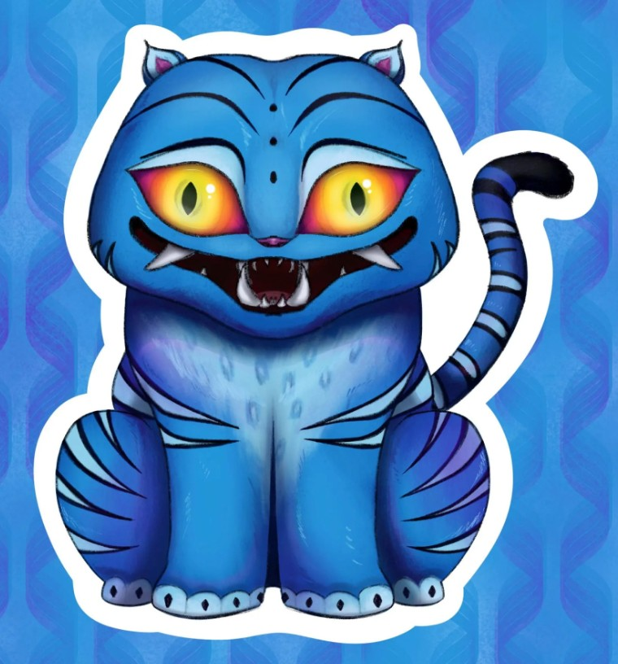

# CapyPop 🍊

A browser-based Bubble Shooter-inspired arcade game starring Kibaraska. Set aboard a moving train, players must match colourful demon clusters, protect friendly idols and unleash special abilities to survive five increasingly challenging levels.

Check it on the web:

https://tanishasharma11.github.io/CapyPop/

Or:

Open `index.html` in a modern browser.  No dependencies or build process are required.

## 🚆 Game Preview

## 🎮 About the Game

A mysterious demon invasion has taken over the train in Seoul!

Play as Kibaraska, aim colourful energy orbs at incoming demons and match groups of three or more to clear them.
But be careful: friendly idols may appear among the enemies. 
Hitting them costs you a life!

Build combos, charge your Fever meter, activate special abilities and defeat the final boss to complete your journey.

## ✨ Game Features

### 🍬 1. Bubble Shooter-Inspired Gameplay
- Shoot colourful energy orbs towards incoming demon formations.
- Match three or more connected demons of the same colour.
- Clear larger clusters to earn more points.
- Plan your shots carefully and avoid friendly idols.

### 💜 2. Protect the Friendly Idols
- Friendly idol characters appear during the journey.
- They must be protected from incoming shots.
- Accidentally hitting a friendly idol costs one life.
- Use the Derpy Guardian Shield to protect against one friendly-fire hit.

### 🛡️ 3. Special Abilities

The game features three special abilities:

| Key | Ability | Effect |
|---|---|---|
| Q | Derpy Guardian Shield | Activates a six-second shield that blocks one friendly-fire hit. Derpy appears beside Kibaraska while the shield is active. |
| E | Sussie Booster | Activates an eight-second boost and adds 30 points to the Fever meter. |
| F | Kibaraska Fever | Unleashes a powerful attack that clears up to five demons when the Fever meter reaches 100%. |

### 🔥 4. Fever Meter and Combo System
- Earn Fever points by successfully matching demon clusters.
- Build combos to increase your scoring multiplier.
- Fill the Fever meter to unlock Kibaraska's special attack.
- Activate Fever Blast to clear up to five demons at once.

### 🚆 5. Five Levels of Demon Action

Progress through five themed levels, each with its own demon formation and challenge.

1. **First Fan Encounter** – Begin your journey and learn the matching mechanics.
2. **Tunnel Trouble** – Face more challenging demon formations.
3. **Idol Safe Zone** – Protect friendly idols while clearing demons.
4. **Demon Encore** – Take on larger formations and build powerful combos.
5. **The Headliner** – Face the final boss and defeat the demon headliner!

The fifth level introduces a boss battle with a health bar.

### 🍊 6. Rewards and Scoring
- Earn points for clearing demon clusters.
- Build combos to increase your score.
- Collect orange rewards through gameplay.
- Earn additional rewards for completing levels.
- Track your best score and accumulated rewards.

### 🎵 7. Sound and Music
- Background gameplay music with looping playback.
- Independent music and sound-effects controls.

### 📱 8. Desktop and Mobile Support
- Mouse and touchscreen aiming and shooting.
- Keyboard controls for desktop gameplay.
- Dedicated on-screen Fever Blast button when the Fever meter is full.
- Responsive interface for smaller screens.

---

## 🕹️ Controls

| Input | Action |
|---|---|
| Mouse movement / Touch | Aim |
| Mouse click / Touch | Shoot |
| Spacebar | Shoot the orbs |
| Q | Activate Derpy Guardian Shield |
| E | Activate Sussie Booster |
| F | Activate Kibaraska Fever |
| On-screen F button | Activate Fever Blast on mobile |

**Tip:** Save your special abilities for situations where they can make the biggest difference!

---

## 🛠️ Built With

- **HTML5** – Game structure and interface.
- **CSS3** – Styling, layout and responsive design.
- **JavaScript** – Game mechanics, animations, scoring and interactions.
- **HTML5 Canvas** – Rendering the game environment, characters, demons and effects.
- **Web Audio API** – Arcade sound effects.
- **HTML Audio** – Background gameplay music.

## 🎯 Objective

Clear all demon formations, protect the friendly idols, use your special abilities strategically and defeat the final boss.

**Can you save the Demon Express?**

---

## Game Screenshots 

#### Fever Blast

#### Derpy Shield

  Made with 💜, 🍊 and a little bit of demon-hunting energy.
   
  <strong>CAPYPOP</strong>

